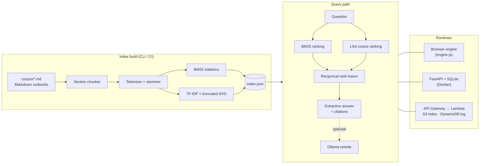

# RunbookRAG

**Describe an incident in plain words and get the matching runbook steps, with a citation for every sentence.**

[](https://github.com/Gonugunta-Venkata-Jayanth/RunbookRAG/actions/workflows/ci.yml)
[](LICENSE)
[](https://www.python.org/)
[](https://fastapi.tiangolo.com/)
[](infra/terraform)
[](https://gonugunta-venkata-jayanth.github.io/RunbookRAG/)

---

## Overview

During an incident, the fix is usually written down somewhere, but finding it means guessing the exact words the
runbook author used. RunbookRAG is a retrieval-augmented question answering system for operations runbooks. It
indexes Markdown runbooks section by section, retrieves the sections most relevant to a free-text description of
the problem, and composes a short answer quoted verbatim from those sections, with a citation on every sentence.

Retrieval combines two signals:

- **Lexical**: Okapi BM25, which rewards exact matches on error strings such as `EADDRINUSE` or `203/EXEC`.
- **Semantic**: Latent Semantic Analysis (TF-IDF followed by a truncated SVD), which matches related vocabulary
  such as "storage" and "disk" through their co-occurrence in the corpus.

The two rankings are merged with reciprocal rank fusion. Answers are extractive by default, so the system needs no
model server, never paraphrases a command incorrectly, and refuses to answer when the runbooks do not cover the
question. An optional generative step can rewrite the answer through a local Ollama model.

The whole engine is a single JSON index plus a few hundred lines of Python. The same index is served by a FastAPI
container, by an AWS Lambda function behind API Gateway, and by a JavaScript port that runs entirely in the browser.
CI checks that the Python and JavaScript engines return identical rankings and answers.

The bundled corpus contains 22 runbooks (88 sections) written for this project, covering Linux, containers,
networking, PostgreSQL and AWS.

## Key Features

- **Hybrid retrieval**: BM25, LSA and reciprocal rank fusion, selectable per request (`hybrid`, `bm25`, `dense`).
- **Grounded answers**: up to three sentences quoted from the top-ranked runbook, each cited to its section.
  Answers are withheld when they would cover less than a third of the question's terms.
- **No model required**: the default path is pure NumPy; an Ollama model can be enabled with one environment
  variable for generative rewriting, and the extractive answer is still returned if the model fails.
- **One index, three runtimes**: FastAPI (Docker), AWS Lambda, and an in-browser engine, all reading the same
  `index.json` and verified for parity in CI.
- **Feedback loop**: every answer gets a query id; helpful or unhelpful votes are stored in SQLite (container) or
  DynamoDB (AWS) and summarised by `/api/stats`.
- **Measured quality**: a labelled evaluation set, Recall@k and MRR per retrieval mode, answer rate and citation
  precision, and a CI gate that fails the build when retrieval quality drops.
- **Infrastructure as code**: Terraform for S3, DynamoDB, Lambda, API Gateway, IAM and CloudWatch, sized for the
  AWS Free Tier and validated in CI.

## Architecture



| Path | Purpose |
| --- | --- |
| `runbookrag/` | Core library: corpus parsing, tokenisation, index build, retrieval, answers, evaluation, SQLite store |
| `api/main.py` | FastAPI service and static dashboard host |
| `aws/handlers.py` | Lambda handler for API Gateway HTTP API (payload v2), S3 index, DynamoDB query log |
| `frontend/` | Dashboard (HTML, CSS, vanilla JS) and `engine.js`, the in-browser port of the retriever |
| `infra/terraform/` | AWS deployment |
| `corpus/`, `eval/` | Runbooks and the labelled evaluation queries |
| `scripts/` | Evaluation, benchmark, parity export, demo build and Lambda packaging |

## Tech Stack

| Layer | Technology |
| --- | --- |
| Retrieval and ranking | Python 3.12, NumPy (BM25, TF-IDF, SVD, reciprocal rank fusion) |
| API | FastAPI, Uvicorn, Pydantic |
| Storage | JSON index; SQLite (container) or DynamoDB (AWS) for queries and feedback; S3 for the index |
| Frontend | HTML, CSS, vanilla JavaScript (ES modules), no build step |
| Optional generation | Ollama (local, self-hosted) |
| Infrastructure | Terraform, AWS Lambda (arm64), API Gateway HTTP API, S3, DynamoDB, CloudWatch Logs |
| Quality | pytest, pytest-cov, Ruff, Node.js test runner, GitHub Actions, Docker |

## Getting Started

Requirements: Python 3.11 or later. Node.js 20 or later is needed only for the JavaScript parity tests.

```bash
git clone https://github.com/Gonugunta-Venkata-Jayanth/RunbookRAG.git
cd RunbookRAG
pip install -r requirements-dev.txt

python -m runbookrag build                       # index corpus/ into build/index.json
python -m runbookrag search "nginx 502 bad gateway"
python -m runbookrag ask "container exits with code 137"
uvicorn api.main:app --reload                     # dashboard and API on http://127.0.0.1:8000
```

With Docker:

```bash
docker build -t runbookrag .
docker run --rm -p 8000:8000 runbookrag
```

### API

| Method | Path | Description |
| --- | --- | --- |
| GET | `/health` | Status, index size and whether a generator is configured |
| GET | `/api/search?q=&mode=&k=` | Ranked sections (`mode`: `hybrid`, `bm25`, `dense`; `k` up to 20) |
| POST | `/api/ask` | `{"question": "...", "mode": "hybrid", "generate": false}` returns answer, citations, coverage and hits |
| POST | `/api/feedback` | `{"query_id": "...", "helpful": true}` |
| GET | `/api/runbooks`, `/api/runbooks/{id}` | Corpus listing and full runbook |
| GET | `/api/stats` | Query count, answer rate, latency, helpful rate, most retrieved sections |

Interactive documentation is available at `/docs`.

### Configuration

| Variable | Default | Description |
| --- | --- | --- |
| `RUNBOOKRAG_INDEX` | `build/index.json` | Index path; built from `RUNBOOKRAG_CORPUS` on start-up if missing |
| `RUNBOOKRAG_CORPUS` | `corpus` | Directory of Markdown runbooks |
| `RUNBOOKRAG_DB` | `data/runbookrag.db` | SQLite database for queries and feedback |
| `RUNBOOKRAG_CORS` | `*` | Comma-separated allowed origins |
| `RUNBOOKRAG_OLLAMA_URL` | unset | Enables generative rewriting, for example `http://localhost:11434` |
| `RUNBOOKRAG_OLLAMA_MODEL` | `llama3.2:1b` | Ollama model name |

### Adding runbooks

Each runbook is a Markdown file with front matter and `##` sections; every section becomes one retrievable unit.

```markdown
---
title: Redis evicting keys unexpectedly
category: database
tags: redis, memory, eviction
---
## Symptoms
...
## Diagnosis
...
```

Rebuild the index with `python -m runbookrag build`, then add labelled queries to `eval/queries.jsonl` and run
`python scripts/evaluate.py` to confirm quality did not regress.

## Testing

```bash
ruff check .
pytest --cov --cov-report=term-missing                 # 58 tests, 99% line coverage
python -m runbookrag build && python scripts/export_parity.py
node --test frontend/tests/engine.test.mjs             # JavaScript engine matches Python on 92 queries
python scripts/evaluate.py                             # writes reports/evaluation.json
```

The GitHub Actions pipeline runs three jobs on every push and pull request:

1. **Lint, test and evaluate**: Ruff, pytest with a 90% coverage floor, JavaScript parity, a retrieval quality
   gate (hybrid Recall@3 of at least 0.95 and MRR of at least 0.90), a latency benchmark, and the demo and Lambda
   builds.
2. **Terraform validate**: `terraform fmt -check`, `init` and `validate`.
3. **Docker image**: builds the image and smoke-tests search, ask, the dashboard and the evaluation endpoint.

## Deployment

### Static demo (no backend)

`python scripts/build_demo.py` writes `dist/`, a static site in which retrieval runs in the browser from
`index.json` (207 KB, 49 KB gzipped). It can be hosted on any static host; the live demo is served from GitHub Pages (`gh-pages` branch).
To point the dashboard at a deployed API instead, set `apiBase` in `config.js`.

### AWS (Free Tier)

```bash
bash scripts/package_lambda.sh                  # build/lambda.zip: code, index and numpy for arm64
cd infra/terraform
terraform init
terraform apply -var="allowed_origin=https://your-dashboard.example"
```

Terraform creates:

- an encrypted, private, versioned **S3** bucket holding `index.json`, read by the function at cold start;
- a **DynamoDB** table (5 RCU / 5 WCU provisioned, TTL of 90 days) for the query log and feedback;
- an arm64 **Lambda** function (512 MB, 10 s timeout) with a least-privilege IAM role;
- an **API Gateway HTTP API** with CORS and throttling (10 requests per second by default);
- a **CloudWatch** log group with 14-day retention.

The `api_url` output is the value to set as `apiBase`. Resource sizes are chosen to stay within the AWS Free Tier
allowances for Lambda, API Gateway, DynamoDB and S3; check the current Free Tier terms for your account before
deploying.

## Results

All figures below were measured on the bundled corpus and come from `reports/evaluation.json` and
`scripts/benchmark.py`.

**Evaluation set.** 89 hand-written queries, each labelled with the runbook that answers it. The 67 *direct*
queries reuse vocabulary from the runbooks (error messages, command names); the 22 *paraphrase* queries
deliberately avoid it ("the machine ran out of storage" for a full disk). Because the queries and the corpus were
written by the same author, absolute scores are optimistic; the comparison between modes is the useful signal.

Document-level retrieval quality:

| Query set | Mode | Recall@1 | Recall@3 | MRR |
| --- | --- | ---: | ---: | ---: |
| Direct (67) | BM25 | 0.985 | 1.000 | 0.993 |
| Direct (67) | LSA | 0.910 | 1.000 | 0.955 |
| Direct (67) | Hybrid | 0.970 | 1.000 | 0.985 |
| Paraphrase (22) | BM25 | 0.636 | 0.864 | 0.748 |
| Paraphrase (22) | LSA | 0.773 | 0.909 | 0.832 |
| Paraphrase (22) | Hybrid | 0.727 | 0.909 | 0.808 |
| All (89) | Hybrid | 0.910 | 0.978 | 0.941 |

BM25 is strongest when the query contains the runbook's own terms, LSA is strongest on paraphrases, and hybrid
fusion stays close to the better of the two on both sets.

Answer quality (hybrid retrieval):

| Query set | Answer rate | Citation precision |
| --- | ---: | ---: |
| Direct | 0.970 | 0.985 |
| Paraphrase | 0.500 | 1.000 |

*Answer rate* is the share of questions that received a grounded answer rather than a refusal. *Citation
precision* is the share of answered questions whose citations all point to the labelled runbook. On paraphrases
the system prefers refusing to answering from the wrong runbook.

**LSA dimensionality.** Paraphrase MRR for the hybrid mode was 0.808 at 16 dimensions, 0.735 at 32 and 0.720 at
64; 16 is the default. This sweep used the same evaluation set, so it is a design choice rather than a held-out
result.

**Latency** (Python engine, 2-vCPU sandbox, 89 queries repeated 5 times):

| Operation | p50 | p95 |
| --- | ---: | ---: |
| Build index (88 sections) | 27.5 ms | — |
| Hybrid ranking | 0.11 ms | 0.17 ms |
| Hybrid ranking + extractive answer | 0.23 ms | 0.28 ms |

## Roadmap

- Query expansion from a curated synonym list for operations vocabulary.
- Optional neural sentence embeddings as a third ranking signal, keeping the NumPy path as the default.
- A held-out evaluation set written independently of the corpus.
- Ingestion from Git repositories and Confluence exports, with incremental index rebuilds.
- Use of feedback votes to surface runbooks that need rewriting.

## License

Released under the [MIT License](LICENSE). Copyright (c) 2026 Jayanth Gonugunta Venkata.
